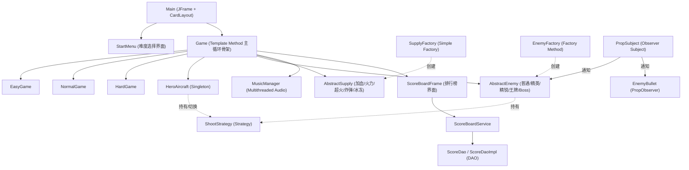
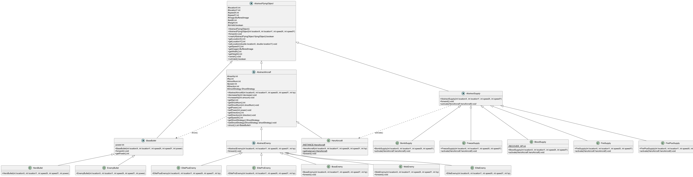

# SkyGuard：基于设计模式架构的 2D 空战街机游戏与重构实践


**SkyGuard**（包路径 `com.aircraftwar`）是一款基于 **Java Swing** 实现的 2D 纵版飞行射击游戏，同时也是一个完整的**面向对象分析与设计（OOAD）及设计模式实战参考项目**。

项目从一个最小可运行的飞行射击原型出发，围绕 **7 种经典设计模式**（单例、简单工厂、工厂方法、策略、DAO、观察者、模板方法）、**Swing 事件驱动图形界面**、**多线程音频与道具定时控制** 以及 **JUnit 5 单元测试** 进行了系统化重构与分层解耦。

---

## 核心特性

- **分层清晰的面向对象领域模型**：以 `AbstractFlyingObject` 为顶层基类，统一封装坐标、速度、边界碰撞检测（AABB 缩放判定）与生命周期状态（`isValid` / `vanish()`），派生飞机、子弹、补给道具三大体系。
- **7 种设计模式工程化落地**：
  - **单例模式（Singleton）**：保障全局唯一的玩家操控对象 `HeroAircraft`，支持跨局状态重置与版本号防冲突恢复。
  - **简单工厂模式（Simple Factory）**：通过 `SupplyFactory` 与 `SupplyType` 统一封装 5 种道具实例创建逻辑。
  - **工厂方法模式（Factory Method）**：通过 `EnemyFactory` 抽象工厂及 5 个具体子工厂隔离不同敌机的构建细节。
  - **策略模式（Strategy）**：通过 `ShootStrategy` 接口实现不射击、单排直射、双排直射、扇形散射、全向环射 5 种弹道算法的运行时热切换。
  - **数据访问对象模式（DAO）**：通过 `ScoreDao` / `ScoreDaoImpl` / `ScoreRecord` / `ScoreBoardService` 实现按难度分文件存储的排行榜持久化与 CRUD 管理。
  - **观察者模式（Observer）**：通过 `PropSubject` 与 `PropObserver` 解耦全屏炸弹、冰冻道具对在场所有敌机与敌机子弹的多态响应。
  - **模板方法模式（Template Method）**：在 `Game.action()` 中固化游戏主循环骨架，由 `EasyGame`、`NormalGame`、`HardGame` 定制难度参数、Boss 生成规则与时间递进曲线。
- **丰富的战斗机制、交互体验与多线程控制**：
  - 5 类敌机（普通、精英、精锐、王牌、Boss）与 5 类补给道具（加血、散射火力、环形超级火力、全屏炸弹、冰冻控场），并通过 `EnemyFactory` 与 `SupplyFactory` 全面接入主循环创建与掉落流程。
  - **便捷操控与可视化 HUD**：支持开始菜单与局内音效开关（`M` 键一键静音/恢复）、局内暂停/继续（`P` / `SPACE` 键并绘制半透明暂停遮罩）、英雄机血量进度条与 Boss 顶部血条实时渲染，以及排行榜结算后一键返回主菜单的完整闭环。
  - 独立守护线程驱动的音效引擎（`MusicThread` + `MusicManager`），支持循环 BGM（普通 / Boss 切换）与单次音效并发播放及安全中断回收。
  - 基于版本戳（`fireVersion`）的多线程限时火力加成（`FirePowerRunnable`），避免旧定时器线程误覆盖新拾取的火力状态。
- **完整文档、UML 图、教学示例与单元测试**：提供全套 PlantUML 源码（`uml/`）、高清架构类图（`docs/images/`）、配套独立模式示例（`examples/`）及覆盖核心实体、工厂、观察者与 DAO 层的 JUnit 5 单元测试（`test/`）。

---

## 整体架构与设计模式总览



### 设计模式映射表

| 设计模式 | 核心角色与类 | 解决的工程问题 | 详细文档 |
| :--- | :--- | :--- | :--- |
| **单例模式 (Singleton)** | `HeroAircraft`（饿汉式 + 版本号同步） | 防止多英雄机实例导致碰撞、计分与控制混乱，支持多局重开状态重置 | [架构解析 §2](docs/architecture-and-patterns.md#2-单例模式-singleton) |
| **简单工厂 (Simple Factory)** | `SupplyFactory`, `SupplyType` | 集中管理 5 种固定种类道具的创建与随机抽取，消除调用方分支硬编码 | [架构解析 §3](docs/architecture-and-patterns.md#3-简单工厂模式-simple-factory) |
| **工厂方法 (Factory Method)** | `EnemyFactory` 及其 5 个具体子工厂 | 将多属性差异化敌机的构建逻辑解耦，新增敌机无需修改工厂接口 | [架构解析 §4](docs/architecture-and-patterns.md#4-工厂方法模式-factory-method) |
| **策略模式 (Strategy)** | `ShootStrategy` 及 5 个策略实现 | 分离弹道数学计算与飞机实体，支持拾取火力道具后运行时动态切弹道 | [架构解析 §5](docs/architecture-and-patterns.md#5-策略模式-strategy) |
| **DAO 模式 (Data Access Object)** | `ScoreDao`, `ScoreDaoImpl`, `ScoreRecord`, `ScoreBoardService` | 分离排行榜 UI/业务逻辑与 UTF-8 文本文件持久化，便于替换存储后端与单测 | [架构解析 §6](docs/architecture-and-patterns.md#6-dao-数据访问对象模式) |
| **观察者模式 (Observer)** | `PropSubject`, `BombPropSubject`, `FreezePropSubject`, `PropObserver` | 实现炸弹与冰冻道具触发时对海量敌机和敌方子弹的松耦合广播与多态响应 | [架构解析 §7](docs/architecture-and-patterns.md#7-观察者模式-observer) |
| **模板方法 (Template Method)** | `Game.action()` (`final`), `EasyGame`, `NormalGame`, `HardGame` | 复用 40ms 主循环算法骨架，通过钩子方法差异化定制难度曲线与 Boss 机制 | [架构解析 §8](docs/architecture-and-patterns.md#8-模板方法模式-template-method) |



---

## 目录结构

```text
skyguard-pattern-arcade/
├── README.md                              # 项目总览与快速运行指南
├── docs/                                  # 深入技术参考文档与 UML 渲染图
│   ├── architecture-and-patterns.md       # 七大设计模式与多线程架构深度解析
│   ├── gameplay-and-mechanics.md          # 飞机/子弹/道具/难度数值与游戏机制手册
│   ├── iterative-refactoring-guide.md     # 六阶段渐进式面向对象重构实践路线
│   └── images/                            # 8 张高清 UML 类图（PNG）
├── examples/                              # 脱离游戏环境的独立设计模式教学示例
│   ├── observer-smart-home/               # 观察者模式示例：智能家居告警联动系统
│   └── template-bank-business/            # 模板方法模式示例：银行业务办理流程
├── score/                                 # 排行榜本地持久化示例数据（按难度隔离）
│   ├── score_easy.txt
│   ├── score_normal.txt
│   └── score_hard.txt
├── src/
│   ├── com/aircraftwar/
│   │   ├── aircraft/                      # 飞机实体层（抽象基类、英雄机、5 种敌机）
│   │   ├── application/                   # 主程序入口、模板方法 Game 主循环、图像与控制
│   │   ├── basic/                         # 顶层飞行物抽象基类 AbstractFlyingObject
│   │   ├── bullet/                        # 子弹实体（HeroBullet / EnemyBullet）
│   │   ├── dao/                           # 排行榜数据访问接口与文件实现
│   │   ├── factory/                       # 敌机工厂方法体系与道具简单工厂
│   │   ├── music/                         # 多线程音频管理器与播放线程
│   │   ├── observer/                      # 道具广播主题与观察者契约
│   │   ├── score/                         # 排行榜领域对象 ScoreRecord 与服务封装
│   │   ├── strategy/                      # 5 种弹道射击策略实现
│   │   ├── supply/                        # 5 种补给道具定义
│   │   ├── thread/                        # 限时火力增益线程 FirePowerRunnable
│   │   └── ui/                            # Swing 难度选择主菜单与排行榜窗口
│   ├── images/                            # 游戏精灵图与背景贴图资源
│   └── videos/                            # 游戏 BGM 与战斗音效（WAV）
├── test/
│   └── com/aircraftwar/                   # JUnit 5 单元测试套件
│       ├── aircraft/HeroAircraftTest.java # 英雄机生命值、移动、射击与版本恢复测试
│       ├── dao/ScoreDaoImplTest.java      # 排行榜写入、降序排序与按名次删除测试
│       ├── factory/SupplyAndEnemyFactoryTest.java # 道具简单工厂与敌机工厂方法测试
│       └── observer/PropObserverTest.java # 炸弹与冰冻道具观察者多态通知测试
└── uml/                                   # 8 份 PlantUML 源码（.puml）
```

---

## 快速开始

### 环境要求

- **JDK**: Java 17 或更高版本（推荐 JDK 17 / 21 / 25）
- **IDE**: IntelliJ IDEA（或支持 Java + JUnit 5 的任意 IDE / 命令行）
- **单元测试依赖**: JUnit 5 (`org.junit.jupiter`)

### 方式一：命令行编译与运行游戏

> [!IMPORTANT]
> 由于 `ImageManager` 和 `MusicManager` 通过相对路径 `src/images/...` 与 `src/videos/...` 读取资源，**运行工作目录必须为仓库根目录 `skyguard-pattern-arcade`**。

**Windows (PowerShell):**

```powershell
cd skyguard-pattern-arcade
mkdir -Force out
Get-ChildItem -Recurse -Filter "*.java" src | ForEach-Object { $_.FullName } | Out-File -Encoding utf8 sources.txt
javac -encoding UTF-8 -d out "@sources.txt"
java -cp out com.aircraftwar.application.Main
```

**macOS / Linux:**

```bash
cd skyguard-pattern-arcade
mkdir -p out
find src -name "*.java" > sources.txt
javac -encoding UTF-8 -d out @sources.txt
java -cp out com.aircraftwar.application.Main
```

*(编译完成后可按需删除临时生成的 `sources.txt`。)*

### 方式二：在 IntelliJ IDEA 中运行游戏与单元测试

1. 使用 IntelliJ IDEA 打开 `skyguard-pattern-arcade` 目录。
2. 在 **Project Structure** 中将 `src` 标记为 **Sources Root**，将 `test` 标记为 **Test Sources Root**，配置 JDK（17+）。
3. 运行游戏主类 `com.aircraftwar.application.Main`，在主菜单勾选/取消音效开关并选择 **简单 / 普通 / 困难** 模式开始对局：
   - **鼠标按住拖拽**：移动英雄机
   - **`P` 或 `空格键`**：暂停 / 继续游戏
   - **`M` 键**：实时开启 / 静音游戏音效
   - **对局结束**：在排行榜弹窗中可保存成绩、删除历史记录或点击“返回主菜单”开启新一局。
4. 运行单元测试：右键 `test/` 目录或打开任意测试类（`HeroAircraftTest`、`ScoreDaoImplTest`、`SupplyAndEnemyFactoryTest`、`PropObserverTest`），如尚未引入 JUnit 5 库，按 IDE 提示一键添加 `JUnit5` 依赖后即可运行全部测试用例。

### 运行独立设计模式示例 (`examples/`)

两个教学示例不依赖第三方库，可直接用 JDK 编译运行：

```bash
# 示例 1：观察者模式（智能家居告警系统）
cd examples/observer-smart-home/src
javac -encoding UTF-8 *.java
java SmartHomeDemo

# 示例 2：模板方法模式（银行业务流程）
cd examples/template-bank-business/src
javac -encoding UTF-8 *.java
java BankDemo
```

---

## 延伸阅读

- [架构与七大设计模式深度解析](docs/architecture-and-patterns.md) — 结合类图与源码剖析每个模式的实现细节、线程安全考量与演进动机。
- [游戏机制与数值设定手册](docs/gameplay-and-mechanics.md) — 完整记录 6 种飞机、5 种道具、5 种弹道及 3 种难度的核心数值与交互矩阵。
- [六阶段面向对象重构实践指南](docs/iterative-refactoring-guide.md) — 梳理从零搭建到最终架构的完整六步迭代思路，适合学习软件重构与设计模式实践。
