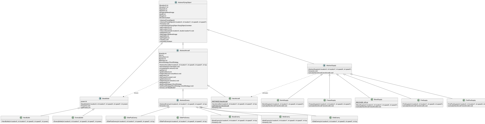
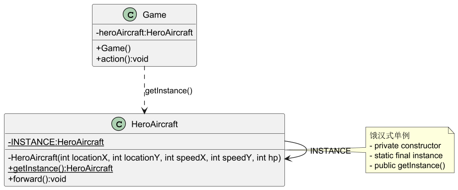
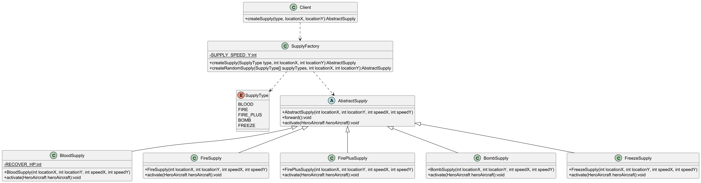
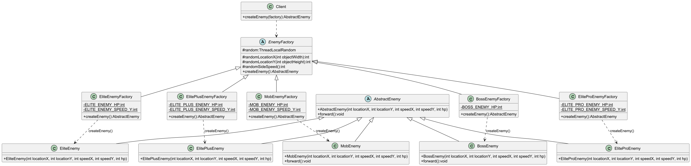
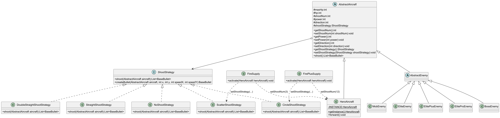
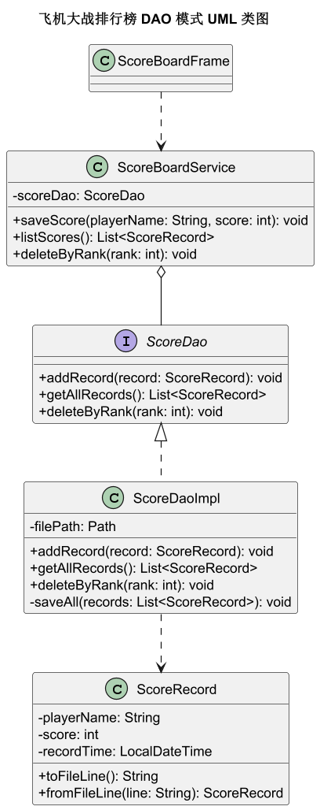
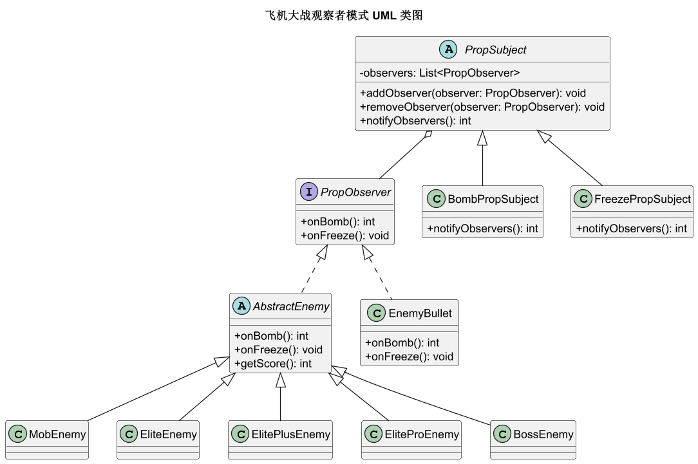
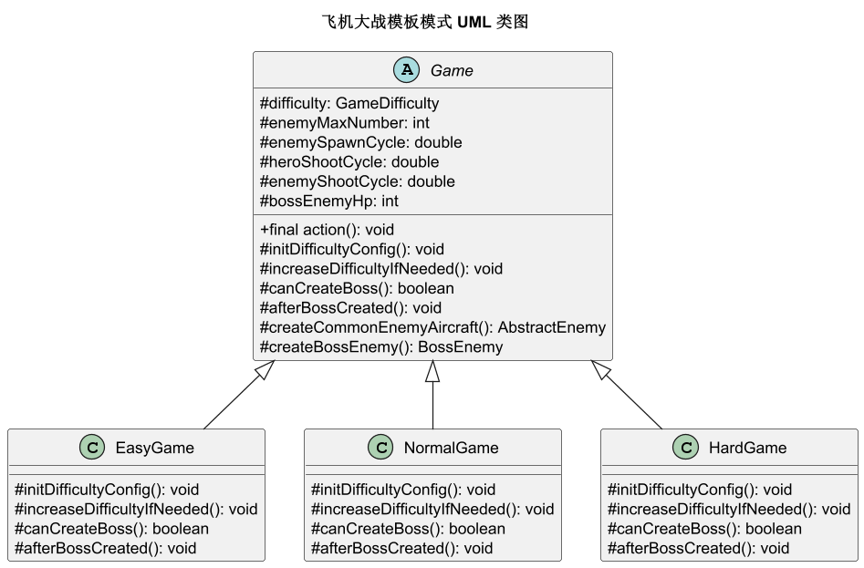

# 架构与七大设计模式深度解析

本文档结合项目源码（`com.aircraftwar.*`）与 PlantUML 架构图（`uml/*.puml`、`docs/images/*.png`），系统阐述 **SkyGuard** 的领域继承体系、7 种经典设计模式的工程实现、并发控制细节以及可改进方向。

---

## 1. 领域模型与实体继承体系

所有屏幕上的可移动实体均继承自顶层抽象基类 `com.aircraftwar.basic.AbstractFlyingObject`，统一管理位置坐标、二维速度、图像缓存、边界碰撞判定与存活标记：

- **通用状态与运动**：封装 `locationX`、`locationY`、`speedX`、`speedY`、`isValid`，并在 `forward()` 中提供横向碰壁反弹逻辑。
- **差异化碰撞盒（Hitbox）**：`crash(AbstractFlyingObject)` 对飞机实例（`instanceof AbstractAircraft`）启用纵向缩放因子 `2`，将飞机纵向判定半径缩小为图像高度的 1/4，提升弹幕躲避手感；对子弹与道具采用完整外接矩形判定。
- **三大业务分支**：
  - `AbstractAircraft` -> `HeroAircraft`、`AbstractEnemy`（派生 `MobEnemy`、`EliteEnemy`、`ElitePlusEnemy`、`EliteProEnemy`、`BossEnemy`）
  - `BaseBullet` -> `HeroBullet`、`EnemyBullet`
  - `AbstractSupply` -> `BloodSupply`、`FireSupply`、`FirePlusSupply`、`BombSupply`、`FreezeSupply`

> 对应的 PlantUML 源码见 [`uml/Inheritence.puml`](../uml/Inheritence.puml)。

---

## 2. 单例模式 (Singleton)

### 2.1 问题背景
一局游戏中只能存在一架由玩家通过鼠标控制的英雄机。若允许外部任意 `new HeroAircraft(...)`，会导致多个实例各自持有生命值、位置与火力状态，引起碰撞判定撕裂与计分不一致。

### 2.2 实现细节：`HeroAircraft`
项目采用**饿汉式单例（Eager Singleton）**结合**并发安全的状态重置**实现 `com.aircraftwar.aircraft.HeroAircraft`：

- **全局唯一实例**：构造器私有化，类加载时初始化静态常量 `INSTANCE`（初始位于窗口底部中央，初始血量 `250`），对外仅暴露 `HeroAircraft.getInstance()`。
- **跨局复用支持**：在 `CardLayout` 多局重开场景下，新增了 `public synchronized void resetState()` 方法，在新一局 `Game` 初始化时重置坐标、速度、生命值、有效标记与默认直射策略。
- **版本化火力控制**：内部维护 `private int fireVersion`，所有弹道切换与恢复方法均用 `synchronized` 修饰（详见 [§9 多线程与并发控制](#9-多线程与并发控制)）。

> 对应的 PlantUML 源码见 [`uml/Singleton.puml`](../uml/Singleton.puml)。

---

## 3. 简单工厂模式 (Simple Factory)

### 3.1 问题背景
游戏中包含加血（`BloodSupply`）、火力（`FireSupply`）、超级火力（`FirePlusSupply`）、炸弹（`BombSupply`）和冰冻（`FreezeSupply`）5 种补给道具。若在敌机坠毁处分散编写条件分支来实例化具体道具，会导致创建逻辑与业务流程紧耦合。

### 3.2 实现细节：`SupplyFactory` & `SupplyType`
- **产品枚举**：`com.aircraftwar.factory.SupplyType` 定义 `BLOOD`、`FIRE`、`FIRE_PLUS`、`BOMB`、`FREEZE` 五种标准类型。
- **工厂类**：`com.aircraftwar.factory.SupplyFactory` 提供：
  - `createSupply(SupplyType type, int locationX, int locationY)`：通过 `switch` 统一封装各道具构造参数（统一 `SUPPLY_SPEED_Y = 6`）。
  - `createRandomSupply(SupplyType[] supplyTypes, int locationX, int locationY)`：支持从限定道具池中随机抽取并生成实例。`Game.createSupplies(...)` 直接通过 `SupplyFactory` 按敌机类型装配不同的掉落池（精英敌机 3 种、精锐敌机 4 种、王牌与 Boss 全部 5 种），彻底消除了主类中的道具实例化分支硬编码。

> 对应的 PlantUML 源码见 [`uml/SimpleFactory.puml`](../uml/SimpleFactory.puml)。

---

## 4. 工厂方法模式 (Factory Method)

### 4.1 问题背景
系统包含 5 种差异显著的敌机（普通、精英、精锐、王牌、Boss），它们在初始坐标范围、横向速度、初始血量与攻击方式上各不相同。简单工厂在面临产品种类持续扩充时会违背**开闭原则（OCP）**。

### 4.2 实现细节：`EnemyFactory` 体系
- **抽象创建者**：`com.aircraftwar.factory.EnemyFactory` 封装共用的随机出生位置与侧向速度工具方法（`randomLocationX`、`randomLocationY`、`randomSideSpeed`），声明抽象工厂方法 `public abstract AbstractEnemy createEnemy()`。
- **具体创建者**：`MobEnemyFactory`、`EliteEnemyFactory`、`ElitePlusEnemyFactory`、`EliteProEnemyFactory`、`BossEnemyFactory` 各自封装对应敌机的默认参数并创建具体敌机实例；同时提供接受动态数值的重载方法 `createEnemy(int hp, int speedY)`（Boss 工厂为 `createEnemy(int hp)`），使 `Game.createCommonEnemyAircraft()` 与 `Game.createBossEnemy()` 在接入动态难度曲线时依然完全通过具体工厂对象创建敌机。

> 对应的 PlantUML 源码见 [`uml/FactoryMethod.puml`](../uml/FactoryMethod.puml)。

---

## 5. 策略模式 (Strategy)

### 5.1 问题背景
不同机型拥有截然不同的射击行为（不射击、单排直射、双排直射、扇形散射、全向环射），且英雄机在拾取 `FireSupply` 或 `FirePlusSupply` 后需要在运行期间实时切换弹道并在到期后恢复。若将弹道计算硬编码在各飞机子类中，会导致类膨胀及大量重复子弹出射代码。

### 5.2 实现细节：`ShootStrategy` 家族
- **上下文（Context）**：`AbstractAircraft` 持有 `protected ShootStrategy shootStrategy` 引用，其 `shoot()` 方法直接委托给 `shootStrategy.shoot(this)`。
- **抽象策略（Strategy）**：`com.aircraftwar.strategy.ShootStrategy` 定义核心契约 `List<BaseBullet> shoot(AbstractAircraft aircraft)`，并通过 `default createBullet(...)` 根据飞机是否为 `HeroAircraft` 自动区分生成 `HeroBullet` 或 `EnemyBullet`。
- **具体策略实现**：
  - `NoShootStrategy`：返回空列表（用于 `MobEnemy`）。
  - `StraightShootStrategy`：纵向单排/多排直线射击（英雄机默认策略）。
  - `DoubleStraightShootStrategy`：对称偏移双排直射（`EliteEnemy`、`ElitePlusEnemy`）。
  - `ScatterShootStrategy`：扇形散射（`EliteProEnemy` 3 发、英雄机火力道具状态 4 发）。
  - `CircleShootStrategy`：以 $2\pi \cdot i / N$ 等分角度计算 `cos`/`sin` 速度矢量的全向环形弹幕（英雄机超级火力状态 15 发、`BossEnemy` 25 发）。

> 对应的 PlantUML 源码见 [`uml/Strategy.puml`](../uml/Strategy.puml)。

---

## 6. DAO 数据访问对象模式

### 6.1 问题背景
排行榜需要将每局成绩持久化到本地文件系统，按游戏难度（简单 / 普通 / 困难）分表存储，并支持查询排名、新增记录、按名次删除及异常行容错。若在 Swing 界面 `ScoreBoardFrame` 中直接读写文本文件，会使 UI 逻辑与存储格式高度耦合，难以单独进行单元测试。

### 6.2 实现细节：`dao` 与 `score` 分层
- **值对象（VO）**：`com.aircraftwar.score.ScoreRecord` 封装 `playerName`（空白时回退为 `"默认玩家"`）、非负校验后的 `score` 与 `recordTime`，并提供制表符转义序列化方法 `toFileLine()` / `fromFileLine()`。
- **数据访问接口**：`com.aircraftwar.dao.ScoreDao` 定义 `addRecord`、`getAllRecords`、`deleteByRank` 三个核心契约。
- **文件持久化实现**：`com.aircraftwar.dao.ScoreDaoImpl` 按难度映射至 `score/score_<difficulty>.txt`（UTF-8 编码），读取时自动跳过损坏行并按 `score` 降序、`recordTime` 升序排列。提供支持注入自定义目录的构造方法 `ScoreDaoImpl(GameDifficulty, Path baseDir)`，方便测试隔离。
- **业务服务封装**：`com.aircraftwar.score.ScoreBoardService` 面向接口 `ScoreDao` 编程，为 `ScoreBoardFrame` 与控制台输出提供统一服务层。

> 对应的 PlantUML 源码见 [`uml/DAOForScoreBoard.puml`](../uml/DAOForScoreBoard.puml)。

---

## 7. 观察者模式 (Observer)

### 7.1 问题背景
当英雄机拾取**炸弹道具（`BombSupply`）**或**冰冻道具（`FreezeSupply`）**时，需同时向当前屏幕中的所有存活敌机与敌方子弹广播效果，并且不同目标的反应差异很大（例如普通敌机被冰冻后永久静止、王牌敌机仅减速 5 秒、Boss 完全免疫）。若在道具类里通过 `instanceof` 逐一判断所有具体实体类，会导致严重耦合。

### 7.2 实现细节：`PropSubject` & `PropObserver`
- **抽象观察者**：`com.aircraftwar.observer.PropObserver` 定义 `int onBomb()`（返回坠毁得分）与 `void onFreeze()`。
- **具体观察者**：
  - `AbstractEnemy` 实现 `PropObserver`，默认 `onBomb()` 立即销毁敌机并返回得分，`onFreeze()` 静止 4 秒；各敌机子类按需重写具体反应。
  - `EnemyBullet` 实现 `PropObserver`，在炸弹触发时清除，在冰冻触发时静止 5 秒后恢复。
- **抽象主题与具体主题**：`PropSubject` 维护去重后的观察者列表 `observers`；`BombPropSubject` 累加所有观察者反馈的得分总和，`FreezePropSubject` 触发全体冻结/减速通知。
- **事件广播**：在 `Game.triggerBombProp()` / `Game.triggerFreezeProp()` 中将当前有效的 `enemyAircrafts` 与 `enemyBullets` 注册为观察者并执行 `notifyObservers()`。

> 对应的 PlantUML 源码见 [`uml/ObserverPattern.puml`](../uml/ObserverPattern.puml)。

---

## 8. 模板方法模式 (Template Method)

### 8.1 问题背景
简单、普通、困难三种模式共享完全一致的 40ms 定时主循环骨架（计时 -> 生成敌机 -> 射击 -> 移动 -> 碰撞检测 -> 难度检查 -> 清理无效对象 -> 重绘界面 -> 胜负结算），但在初始参数配置、时间递进规则与 Boss 召唤逻辑上各不相同。

### 8.2 实现细节：`Game` 与三种难度子类
- **模板方法**：`com.aircraftwar.application.Game` 中的 `public final void action()` 被声明为 `final`，严格锁定主循环执行顺序，防止子类破坏游戏主骨架。
- **原语/钩子方法（Abstract Hooks）**：
  - `protected abstract void initDifficultyConfig()` — 配置初始敌机上限、生成/射击周期、Boss 分数阈值及各敌机生成概率。
  - `protected abstract void increaseDifficultyIfNeeded()` — 每 10 秒触发一次的动态难度调整逻辑（`EasyGame` 为空实现）。
  - `protected abstract boolean canCreateBoss()` — 控制 Boss 是否允许出场（`EasyGame` 返回 `false`）。
  - `protected abstract void afterBossCreated()` — Boss 生成后的后置钩子（`HardGame` 在此将下次 Boss 血量 `+100`）。

> 对应的 PlantUML 源码见 [`uml/TemplatePattern.puml`](../uml/TemplatePattern.puml)。

---

## 9. 多线程与并发控制

### 9.1 独立音频引擎（`MusicThread` & `MusicManager`）
- `MusicThread` 继承 `Thread`（设为守护线程 `setDaemon(true)`），基于 `javax.sound.sampled.Clip` 实现音频加载、单次播放与 `Clip.LOOP_CONTINUOUSLY` 循环播放。
- 针对传统音频线程中途停止难的问题，`stopMusic()` 按顺序设置 `running = false`、同步关闭 `Clip`（`closeClip()`）并调用 `interrupt()`；循环检测 `if (!running)` 以区分“正常中断停止”与“真实异常失败”。
- `MusicManager` 使用 `ConcurrentHashMap<String, MusicThread>` 按键（`"bgm"`、`"boss_bgm"`）管理长驻循环背景音，确保 Boss 登场时无缝叠加、Boss 坠毁或游戏结束时及时释放。

### 9.2 限时火力增益防覆盖机制（`FirePowerRunnable`）
如果玩家在 8 秒火力道具尚未结束时再次拾取新的火力/超级火力道具，旧线程睡眠结束后如果直接恢复直射，会错误地打断新道具效果。项目采用**单调递增版本号（`fireVersion`）**优雅解决该竞态问题：

1. 每次激活 `activateScatterShoot()` 或 `activateCircleShoot()`（均使用 `synchronized` 保护）时，`fireVersion++` 并将最新版本号返回给当前 `FirePowerRunnable` 线程。
2. 线程睡眠 `8000ms` 后调用 `heroAircraft.recoverStraightShoot(version)`。
3. `recoverStraightShoot` 仅当 `version == fireVersion` 时才恢复为 `StraightShootStrategy`，否则说明已有更新的火力增益生效，旧线程自动静默退出。

### 9.3 冰冻与减速状态异步恢复
`AbstractFlyingObject` 中的 `freezeForSeconds(int seconds)` 与 `slowForSeconds(double rate, int seconds)` 在修改实体速度前捕获 `oldSpeedX` 与 `oldSpeedY`，并启动独立恢复线程在延时后检查 `!notValid()`（确认物体未被击毁或出界）再恢复原始速度。

---

## 10. UI 交互闭环与 HUD 状态渲染

- **全局音效开关**：`StartMenu` 提供“开启游戏音效”复选框，`MusicManager` 维护静态 `soundEnabled` 状态，并在对局中支持按 `M` 键调用 `toggleSound(hasBossEnemy())` 实时静音或恢复背景音乐。
- **局内暂停与防误操作**：`Game` 通过 `KeyAdapter` 监听 `P` 与 `SPACE` 键切换 `volatile boolean paused`；暂停期间定时任务跳过状态更新、背景停止滚动、`HeroController` 锁定鼠标拖拽，并渲染居中半透明暂停提示遮罩。
- **双血条可视化 HUD**：左上角在文本外增加英雄机绿/黄/红三段色动态血条（`hp / maxHp`），Boss 在场时在顶部居中绘制 Boss 血量进度条，右上角实时展示当前音效状态与快捷键提示。
- **页面导航闭环**：`ScoreBoardFrame` 新增“返回主菜单”按钮，释放排行榜窗口后调用 `Main.showStartMenu()` 切回 `CardLayout` 的 `"start"` 卡片，配合 `HeroAircraft.resetState()` 实现零重启连续开局。
