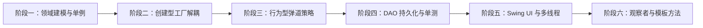

# 六阶段面向对象重构实践指南

本项目在工程演进上采用**敏捷迭代与持续重构**方式推进：先跑通最小可用原型，再随功能复杂度上升逐步引入合适的设计模式消解代码坏味道（Code Smells），最终形成高内聚、低耦合的桌面游戏架构。

以下梳理 6 个核心演进阶段的设计动机、重构手法与关键产出，供阅读源码或复现架构演进时参考。

---

## 演进路线总览

---

## 阶段一：领域建模、继承体系与单例模式

### 重构前痛点
- 初始原型仅包含 `HeroAircraft`、`MobEnemy`、`HeroBullet` 等基础类，缺乏敌机与道具的完整继承抽象，无法统一进行碰撞检测与图形绘制。
- `HeroAircraft` 通过普通构造方法实例化，存在被误创建多架英雄机的风险。

### 重构手法
1. **构建统一实体继承树**：确立 `AbstractFlyingObject -> AbstractAircraft / BaseBullet / AbstractSupply` 三层抽象，扩展 `AbstractEnemy`（派生 5 类敌机）与 5 类道具实现类，编写 `uml/Inheritence.puml`。
2. **英雄机单例化**：将 `HeroAircraft` 构造方法设为 `private`，采用饿汉式静态实例 `INSTANCE` 与 `getInstance()`，保证全局唯一访问点，编写 `uml/Singleton.puml`。

---

## 阶段二：创建型重构——简单工厂与工厂方法

### 重构前痛点
- 敌机销毁后若直接 `new BloodSupply(...)` / `new FireSupply(...)`，会导致道具创建逻辑与游戏主循环高度耦合。
- 5 种敌机具有不同的初始速度、位置约束、血量与评分，直接在 `Game` 中硬编码 `new` 语句不仅代码臃肿，且在未来扩展新敌机时需要大面积改动核心循环。

### 重构手法
1. **道具简单工厂**：提取枚举 `SupplyType` 与工厂类 `SupplyFactory`，提供 `createSupply(...)` 与面向限定掉落池的 `createRandomSupply(SupplyType[], ...)`。
2. **敌机工厂方法**：抽象出 `EnemyFactory`（共享随机坐标与侧向速度辅助逻辑），为 5 种敌机分别建立 `MobEnemyFactory`、`EliteEnemyFactory`、`ElitePlusEnemyFactory`、`EliteProEnemyFactory`、`BossEnemyFactory`，隔离具体产品类的实例化细节。

---

## 阶段三：弹道系统解耦——策略模式

### 重构前痛点
- 英雄机与各类敌机都在各自的 `shoot()` 方法内直接计算子弹坐标与速度，导致 `DoubleStraight`（双排直射）、`Scatter`（散射）、`Circle`（环形弹幕）逻辑在多个类中重复出现。
- 英雄机在拾取火力或超级火力道具后无法在运行时优雅地替换弹道算法。

### 重构手法
1. **定义策略契约**：抽象出 `ShootStrategy` 接口，利用 `default createBullet(...)` 统一区分英雄子弹与敌机子弹的生成。
2. **封装 5 种独立算法**：将弹道数学计算剥离为 `NoShootStrategy`、`StraightShootStrategy`、`DoubleStraightShootStrategy`、`ScatterShootStrategy`、`CircleShootStrategy`。
3. **组合替代继承硬编码**：在 `AbstractAircraft` 中注入 `shootStrategy`，使任意飞机都可在构造或运行时通过 `setShootStrategy(...)` 动态切换火力模式。

---

## 阶段四：数据持久化与质量保障——DAO 模式与 JUnit 5

### 重构前痛点
- 若将得分文件读写逻辑直接塞入 UI 界面或 `Game` 主类，存储格式变化（如从纯文本切换为数据库/JSON）会波及整个应用，且极难在不启动图形界面的前提下完成自动化测试。

### 重构手法
1. **VO + DAO + Service 三层解耦**：
   - `ScoreRecord` 负责字段校验与制表符转义序列化；
   - `ScoreDao` 定义标准增删查接口；
   - `ScoreDaoImpl` 实现按 `GameDifficulty` 分文件持久化（`score_easy.txt` / `score_normal.txt` / `score_hard.txt`），支持注入自定义目录便于测试隔离；
   - `ScoreBoardService` 向下委托 `ScoreDao`，向上服务界面展示与排序输出。
2. **JUnit 5 单元测试覆盖**：
   - `HeroAircraftTest`：覆盖继承自父类的 `decreaseHp()`、`increaseHp()`、`shoot()`，以及 `forward()`、`fireVersion` 弹道恢复逻辑；
   - `ScoreDaoImplTest`：使用 `@TempDir` 临时目录验证记录写入、分数降序排列、按名次删除及越界异常抛出。

---

## 阶段五：交互界面与并发架构——Swing 与多线程

### 重构前痛点
- 此前通过命令行硬编码参数启动单一对局，缺乏难度选择入口与可视化的排行榜管理界面。
- 原始示例 `MusicThread` 仅支持单次播放且缺少外部中断机制；火力道具切换弹道后缺乏定时倒计时自动恢复逻辑。

### 重构手法
1. **Swing 多面板导航与表格交互**：
   - `Main` 采用 `CardLayout` 管理界面切换，实现 `StartMenu`（难度选择）到 `Game` 画布的无缝切换；
   - 对局结束时通过 `SwingUtilities.invokeLater(...)` 在 EDT 事件分发线程安全弹出 `ScoreBoardFrame`，提供保存确认、玩家名称输入及基于 `JTable` 的记录删除与刷新功能。
2. **守护线程音频控制**：重构 `MusicThread` 支持 `Clip.LOOP_CONTINUOUSLY` 循环播放与安全的资源释放 `stopMusic()`，并由 `MusicManager` 通过 `ConcurrentHashMap` 集中管理背景音乐与战斗音效。
3. **限时火力线程防冲突**：通过 `FirePowerRunnable` 实现 8 秒限时效果，并在 `HeroAircraft` 中引入递增版本号 `fireVersion`，防止连续拾取多个火力道具时旧线程提前关闭新火力。

---

## 阶段六：复杂联动与流程复用——观察者模式与模板方法

### 重构前痛点
- **道具联动痛点**：全屏炸弹或冰冻道具触发时，需要让普通/精英/精锐/王牌/Boss 敌机及敌方子弹产生截然不同的反应，如果全在 `Game` 中逐个类型写分支判断，系统每新增一种敌机或控场道具都会产生大量修改。
- **难度控制痛点**：简单、普通、困难三种模式拥有完全一致的游戏主循环，但初始化参数、10 秒动态难度曲线及 Boss 规则不同，复制粘贴三套 `Game` 循环会造成严重逻辑冗余。

### 重构手法
1. **观察者模式解耦 AoE 效果**：定义 `PropObserver`（`onBomb()` / `onFreeze()`）与 `PropSubject`（`BombPropSubject` / `FreezePropSubject`），让所有敌机与 `EnemyBullet` 成为观察者，各自覆写专属响应逻辑，消除跨类硬编码分支。
2. **模板方法模式固化主循环**：将 `Game.action()` 重构为 `final` 模板方法，把易变的难度初始化、时间递增策略、Boss 准入判断与生成后钩子抽象为 4 个受保护方法，由 `EasyGame`、`NormalGame`、`HardGame` 各自实现。

### 配套独立教学示例 (`examples/`)
为了便于在脱离游戏渲染与定时器循环的情况下单独理解阶段六的两种行为型模式，仓库在 `examples/` 下保留了两个可独立编译运行的轻量控制台工程：

- **[`examples/observer-smart-home`](../examples/observer-smart-home)**：以“智能家居告警系统”演示观察者模式——当 `FireAlarm`（火灾报警）或 `SecurityAlarm`（安防报警）触发时，注册在 `AlarmSubject` 上的 `SmartLight`、`SmartDoorLock`、`SmartSprinkler` 分别执行差异化的联动响应。
- **[`examples/template-bank-business`](../examples/template-bank-business)**：以“银行柜面业务办理”演示模板方法模式——`BankBusiness` 通过 `final process()` 固定取号、排队分流、核心业务、反馈评价流程，由 `DepositBusiness` 和 `WealthManagement` 分别通过抽象方法 `doBusiness()` 与钩子方法 `prepare()` / `isVip()` 定制流程差异。

---

## 阶段七（附加扩展）：工程化完善与用户体验增强

在核心功能与七大模式落地的基础上，项目进一步补齐了工程细节与交互体验增强特性：

1. **全链路工厂整合**：`Game` 不再直接 `new` 任何具体敌机或道具，而是统一调用 `EnemyFactory` 各子工厂（支持动态参数重载）与 `SupplyFactory`（支持按敌机等级配置差异化掉落池，补齐 `EliteEnemy` 60% 掉落逻辑）。
2. **音效总开关与快捷键**：在 `StartMenu` 增加音效开关复选框，并在游戏画布内置 `P` / `SPACE` 暂停遮罩、`M` 键实时静音切换与暂停态防拖拽保护。
3. **HUD 血条与多局闭环**：增加英雄机多色血量条与 Boss 顶部血量进度条；在 `ScoreBoardFrame` 增加“返回主菜单”按钮，与 `HeroAircraft.resetState()` 共同形成完整的多局游玩闭环。
4. **单元测试扩展**：在原有 `HeroAircraftTest` 与 `ScoreDaoImplTest` 基础上，新增 `SupplyAndEnemyFactoryTest` 与 `PropObserverTest`，覆盖工厂创建、随机池约束以及炸弹/冰冻观察者多态行为验证。
